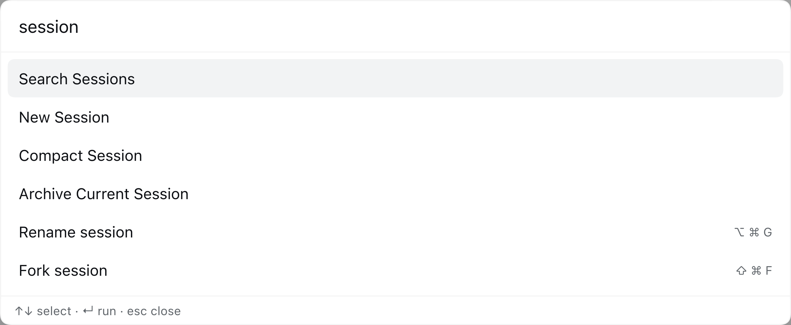
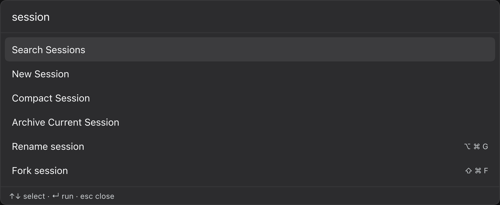

# dsh-spotlight

[](https://github.com/hakulat2023/dsh-spotlight/actions/workflows/test.yml)
[](LICENSE)
[](https://github.com/topics/dsh-plugin)

A Spotlight-style command palette for [DeepSeek Harness](https://github.com/deepseek-ai/deepseek-harness).
Press `Cmd/Ctrl+Shift+P` anywhere, or `/` outside a text field, then search and
run settings, plugins, sessions, shortcuts, themes, and any command another
client plugin registers.

English | [中文](README.zh.md)



<details>
<summary>Dark theme</summary>



</details>

## Table of contents

- [What it does](#what-it-does)
- [Requirements](#requirements)
- [Install](#install)
- [Use](#use)
- [Extending the palette](#extending-the-palette)
- [How it works](#how-it-works)
- [Compatibility and limits](#compatibility-and-limits)
- [Troubleshooting](#troubleshooting)
- [Development](#development)
- [License](#license)

## What it does

- **Global palette.** One overlay entry in `shell.overlay`, opened by keyboard
  or by any registered command.
- **First-class commands.** Settings, Plugins, Search Sessions, Add Workspace,
  Keyboard Shortcuts, New Session, Archive Current Session, Compact Session,
  Toggle Sidebar, Toggle Right Sidebar, Workspace Files, theme (dark / light /
  system), and language (English / 中文).
- **Shortcut mirror.** Every remaining configurable shell shortcut appears in a
  **Shortcuts** group with its effective keycaps. Running one goes through the
  shell's own shortcut resolution, so rename, fork, split, fullscreen, terminal,
  and future feature commands participate without plugin-specific wiring.
  Window/page close and delete/remove actions are deliberately excluded.
- **Extensible registry.** Other client plugins contribute commands through the
  `spotlight` service. Titles, groups, keywords, and hints are searchable in
  English and Chinese.
- **Owned resources.** The stylesheet is injected during bundle materialization
  and claimed by the module system; the locale dictionary, command registry,
  shortcut entries, and overlay slot are registered as Cordis effects, so
  disable / HMR teardown removes them.

## Requirements

| | |
|---|---|
| DeepSeek Harness | `0.2.x` (developed and verified against `0.2.1-rc.5`) |
| Surface | Web client (`dsh-web-app`) or the desktop app |
| Node.js | not needed for the plugin itself; the test suite runs on Node 20+ |
| Build | none — the browser bundle is hand-written JavaScript |

## Install

The package is a DSH **bundle**: `package.json` declares `dsh.bundle.patch` and
`dsh.client`, and `cordis.patch.yml` inserts the host row.

### From GitHub

```bash
dsh plugin --profile desktop add github:hakulat2023/dsh-spotlight#v1.0.1
```

Omit `#v1.0.1` to track the default branch.

### From a local checkout

```bash
plugin_manager install_bundle target: /absolute/path/to/dsh-spotlight
# or
dsh plugin --profile desktop add /absolute/path/to/dsh-spotlight
```

The installer must leave `dsh-spotlight` in the profile's
`dsh.profile.bundles` list, not only in `dependencies`. A dependency without a
bundle selection never composes the host row, so the client half never reaches
the module graph.

**Restart the application after installing or updating.** The host half is a
Node module and the running process keeps the module generation it already
loaded; the client module graph also snapshots each bundle before publication,
so a page reload alone can keep serving the previous bundle. A restart
guarantees the new client half and re-registers the palette shortcut with the
native keyboard bridge.

## Use

| Shortcut | Effect |
|---|---|
| `Cmd/Ctrl+Shift+P` | Toggle the palette (a real `ctx.shortcuts` command; rebindable) |
| `/` (outside inputs) | Open the palette |
| `↑` / `↓` | Move the highlight |
| `Enter` | Run the highlighted command |
| `Esc` | Close |

The opener is registered through the shell's shortcut service. It appears in
**Settings → Shortcuts**, honors user overrides, and works on Desktop through
the native keyboard bridge.

`Cmd/Ctrl+Shift+/` is intentionally not the default: macOS reserves it for the
Help menu's search field, so Electron consumes it before the page can see a
`keydown`. It may still work on Windows/Linux, but it is not reliable on macOS.
Use `Cmd/Ctrl+Shift+P`.

The palette does not open while another modal layer is open: a modal marks the
rest of the application inert, so a palette input could not receive focus.
Escape and Tab are handled by the palette, and focus returns to the element that
was active before it opened.

### Built-in commands

| Group | Commands |
|---|---|
| Navigate | Open Settings, Open Plugins, Search Sessions, Add Workspace, Keyboard Shortcuts |
| Session | New Session, Archive Current Session, Compact Session |
| View | Toggle Sidebar, Toggle Right Sidebar, Workspace Files |
| Appearance | Theme: Dark, Theme: Light, Theme: System, Language: English, Language: 中文 |

**Archive Current Session** uses the shell's `session.archive` shortcut, so it
inherits the running-work confirmation and the archive/undo notice.
**Compact Session** executes the Host's `/compact` command through
`remote.commands.execute`; it requires an idle agent and compactable history.
**Workspace Files** and **Toggle Right Sidebar** use their shell shortcuts first
and fall back to the `sidebarRight` controller.

### Shortcuts group

The palette mirrors the shell's configurable shortcut directory. Each row shows
the command's localized label and its effective keycaps. This is how commands
without a public client service — rename, fork, split, fullscreen, terminal, and
future feature commands — become runnable from the palette.

The mirror uses the shell's own `resolve()` path, so a command can be blocked
when there is no current session, focused page, or idle agent. The palette
closes before the command runs and does not intercept that reason. Window/page
close and delete/remove actions are filtered out of the mirror.

## Extending the palette

Other client plugins register commands through the `spotlight` service:

```js
export const inject = ['spotlight'];

export function apply(ctx) {
  ctx.effect(() => ctx.spotlight.register({
    id: 'my-plugin.do-something',
    title: 'Do something',           // literal fallback
    titleKey: 'cmd.doSomething',      // optional key in the spotlight namespace
    group: 'My plugin',
    hint: '⌘⇧D',                     // optional right-aligned hint
    keywords: ['something', '做事'],
    run: (ctx) => { /* ... */ },
  }), 'my-plugin: spotlight command');
}
```

`register()` requires a non-empty `id` and a `run` function. It returns a
disposer; attach it to a Cordis effect so disabling the contributing plugin
removes the command.

`titleKey` is looked up in the `dsh-spotlight` locale namespace. Commands from
other namespaces should pass a literal `title` (or leave `titleKey` out) so the
fallback is their own text. `keywords` accepts any searchable terms; Chinese and
English are both indexed.

The service surface is:

```ts
interface SpotlightService {
  register(command: SpotlightCommand): () => void;
  list(): SpotlightCommand[];
  open(): void;
  close(): void;
  toggle(): void;
  isOpen(): boolean;
}
```

## How it works

- **Host half** (`index.js`) is a no-op Cordis row. Its only job is to make the
  package a loader entry; the client half is what users see.
- **Client half** (`client.js`) is one `window.__ModuleLoader__.load({ id,
  factory })` module. It requires only `react` from the shared platform table.
- **One stylesheet.** The CSS is inserted during bundle materialization and
  claimed by the module system (`data-plugin-css`), so disable/HMR teardown
  removes it without a manual listener.
- **One overlay slot.** The palette registers into `shell.overlay` and returns
  `null` while closed, so it costs one inert slot entry when unused.
- **Owned effects.** Locale dictionaries, built-in commands, the `spotlight`
  service, the keyboard listener, and the shortcut registrations all live in
  `ctx.effect`, which makes repeated apply/dispose safe.
- **Shortcut registration.** `Cmd/Ctrl+Shift+P` is a normal `ctx.shortcuts`
  command. The service may mount after this plugin, so registration waits with
  `ctx.inject(['shortcuts'], ...)` instead of racing `ctx.get()`.
- **Shortcut mirror.** The palette subscribes to `ctx.shortcuts.catalog`,
  mirrors its non-curated rows into a **Shortcuts** group, and invokes a row via
  the shell registry. Web keeps a synthetic-key fallback for versions where
  that registry is unavailable.

No build step, no runtime dependencies, and no imports from `@deepseek-ai/*`
packages: a third-party plugin cannot resolve the DSH package tree at runtime.

## Compatibility and limits

- The bare `/` opener is a raw capture listener because the shortcut service
  rejects modifier-less defaults; it is not rebindable. `Cmd/Ctrl+Shift+P` is
  the normal, rebindable command.
- The legacy `Cmd/Ctrl+Shift+/` listener remains as a convenience where the OS
  delivers the event (Windows/Linux); macOS consumes it for Help menu search.
- The **Shortcuts** mirror calls `ctx.shortcuts.registry.invoke()`, an internal
  member of the shortcut service rather than a documented public API. Every
  step is guarded. If the registry is absent, Web replays the effective
  binding and Desktop keeps only the first-class commands.
- A mirrored command runs through the shell's own `resolve()` and can be
  blocked without a current session, focused page, or idle agent. The palette
  closes before the command runs and does not show a blocked reason.
- **Compact Session** requires an idle agent; the Host's refusal is logged to
  the browser console.
- Window/page close and delete/remove actions are excluded from the mirror.
- Empty groups render no heading; commands without a group/title fall back to
  their id.
- The palette is keyboard-first, but the list is not a full ARIA combobox; it
  exposes a dialog, a listbox, and option roles.

## Troubleshooting

### The palette does not appear after install

Confirm `dsh-spotlight` is in `dsh.profile.bundles`:

```json
{
  "dsh": {
    "profile": {
      "bundles": ["@deepseek-ai/dsh-base", "@deepseek-ai/dsh-web-app", "dsh-spotlight"]
    }
  }
}
```

Then restart the app. A package in `dependencies` without a bundle selection
does not compose the host row.

### `Cmd+Shift+P` does nothing

Open **Settings → Shortcuts**, search for **Spotlight**, and check its binding.
Another command may claim the same combination; rebind it there. On Desktop the
native keyboard bridge applies the saved binding.

### `Cmd+Shift+/` does nothing on macOS

Expected: macOS assigns it to the Help menu search. Use `Cmd+Shift+P`.

### A mirrored shortcut closes the palette but nothing happens

The shell rejected the command: there may be no current session, the focused
page may not support the action, or the agent may be busy. Use the command from
its native surface once the preconditions are met.

## Development

```bash
npm test
```

`test/verify.mjs` evaluates `client.js` in a VM with DOM, React, and Cordis
context doubles. It asserts that apply registers one owned stylesheet, one
locale namespace, the built-in commands, the `spotlight` service, the keyboard
listener, and the `shell.overlay` entry; it then renders the palette, filters
it, runs first-class and mirrored commands, and closes it.

The test suite has no dependencies. It runs on Node 20+ and is exercised by the
GitHub Actions workflow in `.github/workflows/test.yml`.

For manual verification, boot any profile that composes the bundle:

```bash
dsh plugin --profile web add github:hakulat2023/dsh-spotlight#v1.0.1
dsh --profile web --no-open --port 0
```

Then open the printed URL, press `Cmd/Ctrl+Shift+P`, and check Settings,
Workspace Files, Toggle Right Sidebar, Archive Current Session, and Compact
Session.

## License

[MIT](LICENSE) © 2026 hakulat2023
