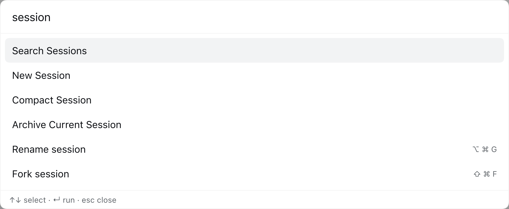
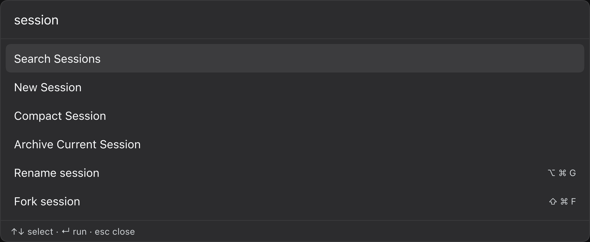

# dsh-spotlight

[](https://github.com/hakulat2023/dsh-spotlight/actions/workflows/test.yml)
[](LICENSE)
[](https://github.com/topics/dsh-plugin)

一个快捷键，直达一切。按 `Cmd/Ctrl+Shift+P`（或在非输入框位置按 `/`）唤出 Spotlight 风格命令面板，
页面、面板、会话、主题、命令——瞬间调起。

[English](README.md) | 中文



<details>
<summary>深色模式</summary>



</details>

## 目录

- [功能](#功能)
- [环境要求](#环境要求)
- [安装](#安装)
- [使用](#使用)
- [扩展命令](#扩展命令)
- [实现方式](#实现方式)
- [兼容性与限制](#兼容性与限制)
- [故障排查](#故障排查)
- [开发](#开发)
- [许可证](#许可证)

## 功能

- **全局面板。** 在 `shell.overlay` 中注册一个覆盖层，可用键盘或任意已注册命令打开。
- **内置命令。** 打开设置、插件页、搜索会话、添加工作区、键盘快捷键速查、新建会话、
  归档当前会话、压缩当前会话、收起/展开左侧栏、展开/收起右侧栏、工作区文件、
  深色/浅色/跟随系统主题、中英文切换。
- **设置直达。** 设置页的每个分区都会生成一条「设置 → 分区」命令（设置 → 通用、
  设置 → 模型、设置 → 插件……），执行后直接打开设置并定位到该标签页。分区目录
  来自 shell 的 `settings.section` 插槽并随其刷新，第三方插件注册的分区也会自动
  出现。Store 句柄不可用时回退为打开设置后按序点击分区导航。
- **快捷键镜像。** 其余可配置的 shell 快捷键会自动出现在 **快捷键** 分组中，
  并显示当前键帽。执行时走 shell 自身的快捷键解析，因此重命名、分叉、分栏、
  全屏、终端以及未来新增的命令都无需逐个接入。关闭窗口/页面和删除类动作会被排除。
- **可扩展注册表。** 其他客户端插件通过 `spotlight` 服务注册命令；标题、分组、
  关键词与键帽提示都支持中英文搜索。
- **资源自管理。** 样式在 bundle 物化时注入并由模块系统认领；语言字典、
  命令注册、快捷键与覆盖层插槽都挂在 Cordis effect 上，禁用或 HMR 重载时会一并清理。

## 环境要求

| | |
|---|---|
| DeepSeek Harness | `0.2.x`（在 `0.2.1-rc.5` 上开发和验证） |
| 运行界面 | Web 客户端（`dsh-web-app`）或桌面应用 |
| Node.js | 插件本身不需要；测试套件需要 Node 20+ |
| 构建 | 无，浏览器 bundle 是手写 JavaScript |

## 安装

本包是一个 DSH **bundle**：`package.json` 声明 `dsh.bundle.patch` 与 `dsh.client`，
`cordis.patch.yml` 插入宿主行。

### 从 GitHub 安装

```bash
dsh plugin --profile desktop add github:hakulat2023/dsh-spotlight#v1.0.3
```

省略 `#v1.0.3` 可跟踪默认分支。

### 从本地目录安装

```bash
plugin_manager install_bundle target: /absolute/path/to/dsh-spotlight
# 或
dsh plugin --profile desktop add /absolute/path/to/dsh-spotlight
```

安装后 `dsh-spotlight` 必须进入 profile 的 `dsh.profile.bundles`，只在
`dependencies` 中不会组合宿主行，client 半也不会进入模块图。

**安装或更新后请重启应用。** 宿主会保留已加载的模块代次，client module graph
也会在发布前快照 bundle；只刷新页面可能仍在跑旧版本。重启才能确保新的 client
半加载，并重新向原生键盘桥接注册面板快捷键。

## 使用

| 快捷键 | 效果 |
|---|---|
| `Cmd/Ctrl+Shift+P` | 打开/关闭面板（真正的 `ctx.shortcuts` 命令，可改键） |
| `/`（输入框外） | 打开面板 |
| `↑` / `↓` | 移动高亮 |
| `Enter` | 执行高亮命令 |
| `Esc` | 关闭 |

打开快捷键通过 shell 的快捷键服务注册，会出现在 **设置 → 快捷键** 中，尊重用户改键，
桌面端由原生键盘桥接触发。

`Cmd/Ctrl+Shift+/` 故意不作为默认值：macOS 把它分配给帮助菜单的搜索框，
Electron 会在页面收到 `keydown` 之前消费掉。Windows/Linux 上可能仍可用，
但 macOS 上不可靠。请使用 `Cmd/Ctrl+Shift+P`。

有其他模态层打开时面板不会启动：模态层会把应用其余部分标记为 inert，
面板输入框无法获得焦点。Escape 和 Tab 由面板处理，关闭后焦点回到打开前的元素。

### 内置命令

| 分组 | 命令 |
|---|---|
| 导航 | 打开设置、打开插件页、搜索会话、添加工作区、键盘快捷键速查 |
| 会话 | 新建会话、归档当前会话、压缩当前会话 |
| 视图 | 收起/展开左侧栏、展开/收起右侧栏、工作区文件 |
| 外观 | 主题：深色、主题：浅色、主题：跟随系统、语言：English、语言：中文 |

**归档当前会话** 复用 shell 的 `session.archive` 快捷键，因此继承运行中确认和
归档/撤销提示。**压缩当前会话** 通过 `remote.commands.execute` 执行 Host 的
`/compact` 命令，要求 Agent 空闲且存在可压缩历史。**工作区文件** 和
**展开/收起右侧栏** 优先走 shell 快捷键，缺失时回退到 `sidebarRight` 控制器。

### 快捷键分组

面板会镜像 shell 的可配置快捷键目录，每行显示本地化标题和当前键帽。
这样没有公开 client 服务的命令（重命名、分叉、分栏、全屏、终端以及未来命令）
也能直接从面板执行。

镜像执行走 shell 自身的 `resolve()`，因此在没有当前会话、没有焦点页面或 Agent
不空闲时可能被拒绝。面板会先关闭，不会拦截并展示拒绝原因。关闭窗口/页面与
删除类动作不会进入镜像。

## 扩展命令

其他客户端插件通过 `spotlight` 服务注册命令：

```js
export const inject = ['spotlight'];

export function apply(ctx) {
  ctx.effect(() => ctx.spotlight.register({
    id: 'my-plugin.do-something',
    title: 'Do something',           // 字面回退
    titleKey: 'cmd.doSomething',      // 可选，查 dsh-spotlight 命名空间
    group: 'My plugin',
    hint: '⌘⇧D',                     // 可选，右侧键帽提示
    keywords: ['something', '做事'],
    run: (ctx) => { /* ... */ },
  }), 'my-plugin: spotlight command');
}
```

`register()` 要求非空 `id` 和 `run` 函数，返回 disposer；请挂到 Cordis effect 上，
这样禁用贡献方插件时命令会被移除。

`titleKey` 只在 `dsh-spotlight` 命名空间中查找。其他命名空间的命令应传字面 `title`
（或不传 `titleKey`），让回退文本来自它们自己。`keywords` 可放任意可搜索词，
中英文都会被索引。

服务接口：

```ts
interface SpotlightService {
  register(command: SpotlightCommand): () => void;
  list(): SpotlightCommand[];
  open(): void;
  close(): void;
  toggle(): void;
  isOpen(): boolean;
}
```

## 实现方式

- **宿主半**（`index.js`）是空操作的 Cordis 行，只负责让包成为 loader entry；
  用户看到的是 client 半。
- **Client 半**（`client.js`）是一个 `window.__ModuleLoader__.load({ id, factory })`
  模块，只从共享平台表 require `react`。
- **单一样式表。** CSS 在 bundle 物化时插入，由模块系统通过 `data-plugin-css` 认领，
  禁用/HMR 卸载时自动移除，不需要手写监听。
- **单个覆盖层插槽。** 面板注册到 `shell.overlay`，关闭时返回 `null`，
  未使用时只占一个惰性插槽项。
- **Effect 管理。** 语言字典、内置命令、`spotlight` 服务、键盘监听和快捷键注册
  都在 `ctx.effect` 中，重复 apply/dispose 安全。
- **快捷键注册。** `Cmd/Ctrl+Shift+P` 是普通的 `ctx.shortcuts` 命令。
  shortcuts 服务可能晚于插件 mount，因此用 `ctx.inject(['shortcuts'], ...)` 等待，
  而不是在 apply 时抢跑 `ctx.get()`。
- **快捷键镜像。** 面板订阅 `ctx.shortcuts.catalog`，把未 curated 的行镜像到
  **快捷键** 分组，并通过 shell registry 执行；registry 不可用时 Web 保留
  合成按键回退。

无构建步骤、无运行时依赖，也不 import 任何 `@deepseek-ai/*` 运行时包：
第三方插件无法从 DSH 包树中解析它们。

## 兼容性与限制

- 裸 `/` 仍是 raw capture listener，因为快捷键服务拒绝无修饰键的默认绑定；
  它不可改键。`Cmd/Ctrl+Shift+P` 才是正常可改键命令。
- 旧 `Cmd/Ctrl+Shift+/` 监听在操作系统愿意投递事件时（Windows/Linux）保留为兜底；
  macOS 会把它用于帮助菜单搜索。
- **快捷键** 镜像调用 `ctx.shortcuts.registry.invoke()`，这是快捷键服务的内部成员，
  不是公开 API。所有访问都有守卫；registry 不存在时 Web 回放实际绑定，
  Desktop 只保留第一类命令。
- 镜像命令走 shell 自身的 `resolve()`，可能因无当前会话、无焦点页面或 Agent
  不空闲而被拒绝；面板先关闭，不展示拒绝原因。
- **压缩当前会话** 要求 Agent 空闲；Host 的拒绝会记录到浏览器 console。
- 关闭窗口/页面与删除类动作不会进入镜像。
- 空分组不渲染标题；没有分组/标题的命令回退到 id。
- 面板以键盘操作为主，但列表不是完整的 ARIA combobox；它暴露 dialog、listbox
  与 option 角色。

## 故障排查

### 安装后面板不出现

确认 `dsh-spotlight` 在 `dsh.profile.bundles` 中：

```json
{
  "dsh": {
    "profile": {
      "bundles": ["@deepseek-ai/dsh-base", "@deepseek-ai/dsh-web-app", "dsh-spotlight"]
    }
  }
}
```

然后重启应用。只在 `dependencies` 中、没有 bundle 选择时，宿主行不会被组合。

### `Cmd+Shift+P` 没反应

打开 **设置 → 快捷键**，搜索 **Spotlight**，检查绑定。可能有其他命令占用了
同一组合，在那里改键即可。桌面端由原生键盘桥接应用保存的绑定。

### macOS 上 `Cmd+Shift+/` 没反应

符合预期：macOS 把它分配给帮助菜单搜索。请使用 `Cmd+Shift+P`。

### 镜像快捷键关闭了面板但没有执行

Shell 拒绝了该命令：可能没有当前会话、焦点页面不支持该动作，或 Agent 正忙。
满足前置条件后，从对应原生界面执行。

## 开发

```bash
npm test
```

`test/verify.mjs` 在 VM 中用 DOM、React 与 Cordis context doubles 执行 `client.js`。
它断言 apply 注册一个自有样式表、一个语言命名空间、内置命令、`spotlight` 服务、
键盘监听和 `shell.overlay` 项；然后渲染面板、过滤、执行第一类与镜像命令并关闭。

测试套件无依赖，Node 20+ 可运行，并由 `.github/workflows/test.yml` 在 GitHub Actions
中执行。

手动验证时，启动任意组合了本 bundle 的 profile：

```bash
dsh plugin --profile web add github:hakulat2023/dsh-spotlight#v1.0.3
dsh --profile web --no-open --port 0
```

打开打印的 URL，按 `Cmd/Ctrl+Shift+P`，检查设置、工作区文件、展开/收起右侧栏、
归档当前会话和压缩当前会话。

## 许可证

[MIT](LICENSE) © 2026 hakulat2023
